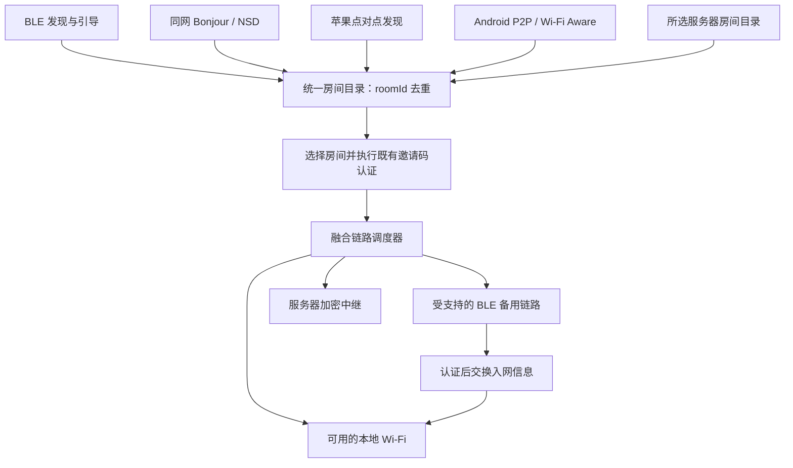

# 融合房统一发现与链路升级方案

日期：2026-10-18。下文“源码现状”记录改动前的核查基线；阶段 A 已完成代码与自动验证，Nearby 已提供独立原型，真机验收尚未完成。实施结果见 [执行记录](FUSION_EXECUTION_2026-10-18.md)，不能把设计目标视为已交付功能。

## 1. 核查结论

当前 Android 1.1.7 / iOS 1.0.6 的同网 Bonjour/NSD 修复，不等于无共同网络的跨平台直连。

| 路径 | 源码现状 | 本轮确认 |
| --- | --- | --- |
| 共同 Wi-Fi/热点 | 两端支持标准 DNS-SD，兼容既有 UDP | 已有实现；仍受权限、AP 隔离及 mDNS 过滤影响 |
| 普通 Wi-Fi 房，iOS ↔ iOS | `NWBrowser` / `NWListener` / `NWConnection` 开启苹果点对点 | 已有实现，不能等同于融合房已接入 |
| 融合房，iOS ↔ iOS 无共同 AP | 原生插件只将 `DAWN_MESH_DISCOVERY_V1` 转入苹果点对点；融合类型走普通 NetService | 确认缺口；融合房尚不能依赖该路径 |
| 融合房，Android ↔ Android | Wi-Fi P2P 服务发现、建组、已认证房间信令协商 | 已有实现；受硬件、权限和 Wi-Fi 并发能力影响 |
| 融合房，iOS ↔ Android 无共同 AP | 未接入跨平台 Wi-Fi Aware、BLE 引导入网或 Nearby Connections | 缺少共同发现与入网协议；仅改广播名称无效 |
| 融合房蓝牙发现/承载 | 融合页面未接入 BLE 房间发现，也未把 BLE 链路接入 FusionTransport | 普通蓝牙房不能直接视作融合房的蓝牙备用链路 |
| 服务器发现 | 页面每 5 秒请求所选服务器 `/api/v1/fusion/rooms`，与本地/P2P 按房间 ID 合并 | 已有基础；不是尚未提供的接口 |
| 服务器入房兜底 | 本地 WebSocket 连接失败后尝试已有 cloud 路径 | 已有连接层兜底；本地连通但认证无响应时，当前流程不等价于完整的入房重试 |

核查文件（仓库相对路径）：

- iOS `ios/Runner/BonjourDiscoveryPlugin.swift`、`ios/Runner/ApplePeerWiFi.swift`。
- 两端 `lib/ui/pages/fusion_home_page.dart`、`lib/core/fusion/fusion_transport.dart`、`fusion_room_directory.dart`、`fusion_server_api.dart`。
- Server `internal/server/fusion.go`：`listFusion`、`syncFusion`、`relayFusion`。

服务器显示房间的当前条件包括：未解散、房主签名状态新鲜（90 秒内），且至少有一条中继连接。房间需预先选定服务器并同步成功；发现者也需能访问同一服务器及通过其访问凭证校验。任何手机都未联网时，服务器不能代替本地发现；签名状态过期的离线房间也不能冒充可加入的在线房间。

## 2. 系统限制与可行方案

### 2.1 蓝牙能做什么

BLE 可作为跨平台发现和控制通道，交换能力、房间标识、临时连接信息，并在认证后协商 Wi-Fi 入网。它不能让 AWDL 与 Android Wi-Fi Direct 自动成为同一种协议，也不能绕过 iOS 入网确认、签名能力或后台限制。

产品流程可统一成“选择一个融合房”，底层按能力选择不同入网方式，而不要求用户先判断设备属于哪个平台。

### 2.2 包含 iPhone XR 的路径

优先验证 Android 的 Wi-Fi Direct Group Owner 对普通 Wi-Fi 客户端的接入；若机型不适合，则评估 LocalOnlyHotspot。Android 提供真实 SSID、口令和实际接口信息，iPhone 作为普通 Wi-Fi 客户端加入。LocalOnlyHotspot 不提供互联网，不得承诺该设备能同时充当公网网关。

iOS 通过 `NEHotspotConfiguration` 经系统确认加入，需验证实际签名 profile 支持 Hotspot Configuration；对普通 Apple 账号或能力不可用的构建保留系统 Wi-Fi 设置/扫码入网路径，不无条件加入 entitlement 导致免费签名失败。不能静默代用户开启 iPhone 个人热点。

房间创建者和提供 Wi-Fi 的设备是两个独立角色。例如 iPhone 创建融合房，由 Android 提供网络，iPhone 加入后仍是原房主；要交换 iPhone 新获得的地址，不能错误地把 Android GO 的地址当作 iPhone 房主的地址，也不固定假设 `192.168.49.1`。

### 2.3 Wi-Fi Aware

适用于支持的较新设备，是独立于现有 AWDL / Wi-Fi Direct 的新传输适配。iPhone 17 Pro / iOS 27 是候选；iPhone XR / iOS 18 不在 Apple Wi-Fi Aware 支持范围内。一加 15T / Android 16 必须运行时检查 `FEATURE_WIFI_AWARE`、当前可用性以及 Aware 配对/安全能力，不能按系统版本或芯片型号推定。

需独立实现双方服务发布、订阅、系统配对、网络连接与断线恢复。能力不满足时选择兼容路径，不让不支持的设备永远停留在“正在直连”。

### 2.4 Google Nearby Connections

这是现成的跨 Android/iOS、结合蓝牙和 Wi-Fi 的候选 SDK，值得做原型对照。Android 官方接入依赖 Google Play services；用户已确认两台安卓机均有 Google Play，原型还会检查 Play services 实际可用性。iOS 高速热点升级也需要相应 capability 和权限，因此不能把 SDK 当作系统限制的绕过方案。

本项目优先保留现有密码学和媒体协议，不直接替换为第三方房间体系。若试验 Nearby，仅把它封装成链路适配器，并验证认证、连接数、语音时延、断线恢复、隐私及 GMS 缺失行为。

## 3. 需要重构的边界

不需要推倒语音、Opus、聊天、PAKE、加密帧和房间身份体系。需要重构的是融合房的发现、入网协商和链路调度；不能只在现有扫描函数里多调一次蓝牙扫描。

### 3.1 发现层：并行收集，不把公网放在最后才查询

进入融合页面即可并行启动允许的近场发现和所选服务器查询。即使本地扫描还在进行，也立即显示服务器房间，避免本地发现失败后额外等待一整轮。无服务器时保持纯本地使用，不强制联网建房。

统一候选结构建议为 `roomId, sourceKind, endpointId, nodeId, capabilities, lastSeen, expiresAt, serverProfileId`。来源包括 LAN、ApplePeer、AndroidP2P、BLE、Aware、Server。每个来源分别失效，失去一个服务不能删除同房间其他仍可用的来源。

现有房间公钥派生 ID 继续作为身份，不用房间名、SSID、四位邀请码或临时 BLE 地址去重。服务器来源不代表物理位置接近；UI 显示“服务器发现 / 本地连接”等真实来源与承载状态。

服务器故障需区分未配置、地址/协议不支持、访问凭证错误、暂时不可达和目录为空。重试有退避，刷新缓存有明确过期时间；保留的旧房间不能显示为已确认在线。

### 3.2 BLE 发现与控制层

为融合房分配独立服务类型/版本，广播仅携带紧凑发现标记，完整房间 ID、名称和能力经有界 GATT 元数据读取。43 字符房间 ID 加房名不能直接塞进传统 BLE 广播包。保留普通蓝牙房协议兼容，不让旧客户端误把融合房作为普通蓝牙房加入。

第一次连接用既有邀请码认证建立受保护控制通道，然后才交换 SSID、口令、网络角色、有效期和实际连接端点。禁止在明文广播、公开 TXT、服务器目录或诊断日志中发送邀请码、WPA 口令、房间密钥或 relay token。BLE 发现只证明发现到一个候选，不等于加入授权。

首版采用前台发现和首次建链；后台/锁屏单独验收。BLE 承载语音并非附带自动获得的能力，需要实现 FusionLink 适配、分片/背压、拥塞和多人容量策略。

### 3.3 链路层：先保持可用连接，再升级

将现有 FusionTransport 的 WebSocket 管理提取为链路接口，例如 `FusionLink.send / incoming / close / health`，适配 LAN WebSocket、ApplePeer WebSocket、BLE 与 Cloud Relay。

连接流程建议为：候选发现 → 认证 → 能力协商 → 建立/验证 Wi-Fi → 迁移媒体。默认保留已工作的 BLE 或公网链路，Wi-Fi 双向探测和加密媒体往返稳定后才迁移；失败回退，不因本地升级失败退出房间。

入房成功的判据是房间身份/邀请码认证完成，不能以 TCP 或 WebSocket 握手成功替代。对陈旧本地候选、握手停滞设置有界尝试；公网候选可在短暂延迟后作为备用连接。多条链路不能各自创建独立成员身份、重复执行不可控入房或重复播放语音。

沿用 FusionPacketCache、成员身份和去重，限制并行拨号与缓存；媒体路由按具体成员/链路计算，不用一个全房间布尔“已直连”掩盖部分成员走公网的事实。

## 4. iOS 融合房点对点接入的必要工作

1. 普通 Wi-Fi 房和融合房分别使用 `_dawnmesh._tcp` 与 `_dawnfusion._tcp`，原生浏览/发布按发现实例 ID 管理，避免互相停止。
2. 两种服务都通过 `NWBrowser`、`NWListener`、`NWConnection` 的 peer-to-peer 参数；保留系统 Bonjour endpoint 的 IPv6 接口作用域。
3. FusionTransport 增加不透明 ApplePeer 服务路由，通过现有 TCP 回环转接建立 WebSocket；不能把发现事件中的 `127.0.0.1` 当成另一台 iPhone 的真实地址直接连接。
4. 发现页面关闭后已建立链路继续存活；重连、取消、退房、服务过期和原生代理失败要释放对应连接，不能销毁别的房间的浏览器或监听器。
5. 本机服务过滤使用实例/节点身份；仅用“地址是否在本机网卡列表”过滤会误排所有 ApplePeer 回环代理候选。
6. 用独立网络/代理测试验证 WebSocket 升级和加密帧双向往返，再用 17 Pro 与 XR 在无共同 AP、关闭蜂窝数据时验收实际无线发现和通话。

仅增加 `includePeerToPeer` 或让列表出现房间不构成完整修复。

## 5. 服务器作为发现与通信兜底

继续复用当前 Fusion API 和签名状态，不为每种无线模式创建不同房间。创建房间后尽快显示服务器同步结果；至少一名已认证、已配置服务器且联网的成员能同步/中继，服务器故障不销毁本地会话。

服务器可以帮助不同网络上的成员找到同一个逻辑房间并建立加密中继，也能承载认证后的链路协商；它不能证明两个设备物理接近、绕过系统入网权限，或让两台完全离线设备经云端发现对方。

当前目录和 relay 已存在，第一阶段无需无依据重写服务端。先检查客户端选择服务器、上传状态、目录刷新和入房兜底的端到端行为；若增加 presence/连接能力等接口，再通过 capability / 协议版本显式协商，保持旧客户端兼容。目录不得公开网络口令、私网详细拓扑或房间认证材料。

## 6. 分阶段交付与验收

| 阶段 | 交付 | 验收要点 |
| --- | --- | --- |
| A | iOS 融合房 ApplePeer 路由；服务器发现/入房兜底明确化 | 17 Pro ↔ XR，无共同 AP；本地无候选时服务器房间仍可显示并入房；未配置/拒权/服务器错误有明确状态 |
| B | 融合房 BLE 发现、统一目录和受保护控制链路 | 两端互相发现融合房；与普通蓝牙房区分；错误邀请码不泄露入网信息 |
| C | Android 提供网络，iOS 经系统确认加入；已认证 BLE/公网保持到 Wi-Fi 稳定 | iOS/Android 任一端创建逻辑房间；XR 可走兼容路径；实际端点、切网后恢复与 Wi-Fi/公网并发能力实测 |
| D | Wi-Fi Aware 或 Nearby 原型择优 | 17 Pro + 一加真实能力、配对、无 GMS、签名能力、时延和稳定性；不影响 XR 的兼容路径 |

每阶段都回归现有邀请码认证、防重放、解散/重连、多人去重、聊天和公网互通。验收矩阵覆盖：共同 AP、无共同 AP、安卓提供网络、AP 隔离、Wi-Fi/蓝牙关闭、权限拒绝、双方/单方有互联网、服务器 401/403/404/超时、房主断网、快速切页、锁屏、三人以上混合平台、BLE 与蓝牙耳机并发。

## 7. 官方依据

- [Apple TN3151：网络 API 与苹果点对点 Wi-Fi](https://developer.apple.com/documentation/technotes/tn3151-choosing-the-right-networking-api)
- [Apple Wi-Fi Aware：支持范围与配对模型](https://developer.apple.com/documentation/WiFiAware)
- [Apple Wi-Fi 配置接口](https://developer.apple.com/documentation/networkextension/wi-fi-configuration)
- [Android Wi-Fi Direct：普通 Wi-Fi 客户端与 Group Owner](https://developer.android.com/develop/connectivity/wifi/wifi-direct)
- [Android WifiP2pGroup：网络名与口令](https://developer.android.com/reference/android/net/wifi/p2p/WifiP2pGroup)
- [Android LocalOnlyHotspot](https://developer.android.com/reference/android/net/wifi/WifiManager#startLocalOnlyHotspot(android.net.wifi.WifiManager.LocalOnlyHotspotCallback,%20android.os.Handler))
- [Android Wi-Fi Aware 与能力检测](https://developer.android.com/develop/connectivity/wifi/wifi-aware)
- [Nearby Connections Swift：热点 capability 与权限](https://developers.google.com/nearby/connections/swift/get-started)
- [Nearby Connections Android：Google Play services 前提](https://developers.google.com/nearby/connections/android/get-started)
